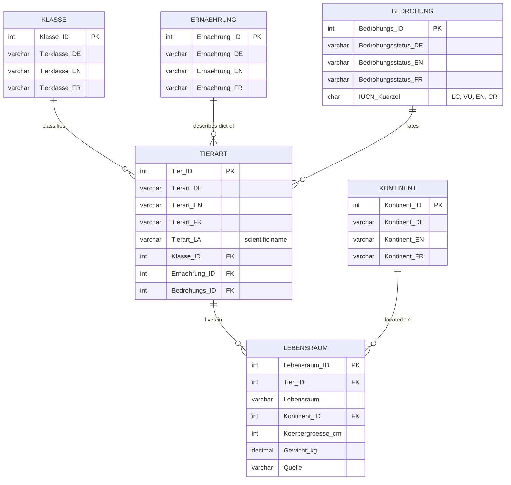

# 🐾 TDB Tiere — Multilingual Terminological Database

**A relational terminology database for animal species in German, English, French and Latin, normalized to 3NF and implemented in MySQL / MariaDB.**

[](https://github.com/Adelyaaibolova/tdb-tiere/actions/workflows/validate-db.yml)


> 🎓 **Data Modelling**, Assignment A3 · European Master in Lexicography (EMLex), 2nd semester\
> 🏛️ **Université de Lorraine**, Nancy, France\
> 👩‍🏫 Professor **Laura Giacomini**\
> 🏆 Grade: **100 / 100**\
> ✍️ Adelya Aibolova · April 2026

---

## Contents

- [About the project](#about-the-project)
- [What this project demonstrates](#what-this-project-demonstrates)
- [Repository structure](#repository-structure)
- [Data model](#data-model)
- [Normalization: from flat table to 3NF](#normalization-from-flat-table-to-3nf)
- [Quick start](#quick-start)
- [Sample queries and results](#sample-queries-and-results)
- [Automated validation (CI)](#automated-validation-ci)
- [Data sources](#data-sources)
- [Academic context](#academic-context)
- [Author](#author)

---

## About the project

A **terminological database (TDB)** stores concepts and their designations across languages. This one covers the domain **zoology**: ten animal species, each documented with its German, English and French name and its scientific Latin name, together with classification, diet, habitat, continent, body measurements, IUCN threat status and the source of every record.

| | |
|---|---|
| **Domain** | Zoology / nature |
| **Languages** | 🇩🇪 German · 🇬🇧 English · 🇫🇷 French · 🔬 Latin (scientific name) |
| **Target users** | Translators, terminologists and students in natural and environmental sciences who need reliable multilingual equivalents |
| **Scope** | 10 species · 6 tables · 5 foreign-key relationships |

**One concept, four designations:**

| 🇩🇪 Deutsch | 🇬🇧 English | 🇫🇷 Français | 🔬 Latin |
|---|---|---|---|
| Weißer Hai | Great White Shark | Grand requin blanc | *Carcharodon carcharias* |
| Kaiserpinguin | Emperor Penguin | Manchot empereur | *Aptenodytes forsteri* |
| Amurtiger | Amur Tiger | Tigre de l'Amour | *Panthera tigris altaica* |

Not only the species names are multilingual: every lookup value (class, diet, continent, threat status) is stored in DE / EN / FR as well, so the whole entry can be displayed in any of the three languages.

---

## What this project demonstrates

- **Conceptual and logical data modelling**: from a flat spreadsheet to an entity-relationship model
- **Normalization** through 1NF → 2NF → 3NF, with a check that the decomposition is **lossless**
- **Relational schema design in SQL**: primary keys, foreign keys, `InnoDB` referential integrity, `utf8mb4` for accented and special characters (é, ü, ß, ')
- **SQL querying**: multi-table `JOIN`s, aggregation (`GROUP BY`, `GROUP_CONCAT`, `AVG`), views
- **Tooling**: XAMPP, phpMyAdmin, MySQL/MariaDB CLI, Excel, CSV export
- **Reproducibility**: GitHub Actions imports the database into MySQL 8.0 and MariaDB 10.11 on every push and runs the tests

---

## Repository structure

```
tdb-tiere/
├── sql/
│   ├── tdb_tiere.sql            # Complete database: schema + data (import this)
│   └── queries.sql              # Sample queries + view v_ausgangstabelle
├── data/
│   ├── excel/
│   │   ├── Ausgangstabelle.xlsx # Original unnormalized source table (10 × 12)
│   │   ├── Tabelle_Tierart.xlsx
│   │   ├── Tabelle_Lebensraum.xlsx
│   │   ├── Tabelle_Klasse.xlsx
│   │   ├── Tabelle_Kontinent.xlsx
│   │   ├── Tabelle_Ernaehrung.xlsx
│   │   └── Tabelle_Bedrohung.xlsx
│   └── csv/                     # Same six tables as UTF-8 CSV (for import or reuse)
│       ├── tierart.csv
│       ├── lebensraum.csv
│       ├── klasse.csv
│       ├── kontinent.csv
│       ├── ernaehrung.csv
│       └── bedrohung.csv
├── docs/
│   └── Bericht_TDB_Tiere.docx   # Project report (German)
├── scripts/
│   └── verify_roundtrip.py      # Lossless-join test: rebuilds the source table from the DB
└── .github/workflows/
    └── validate-db.yml          # CI: import + integrity checks + queries
```

---

## Data model



| Table | Role | Rows | Primary key | Foreign keys |
|---|---|---:|---|---|
| `tierart` | Central entity: the concept and its four designations | 10 | `Tier_ID` | `Klasse_ID`, `Ernaehrung_ID`, `Bedrohungs_ID` |
| `lebensraum` | Habitat, continent, measurements, source | 10 | `Lebensraum_ID` | `Tier_ID`, `Kontinent_ID` |
| `klasse` | Lookup: animal class | 4 | `Klasse_ID` | — |
| `ernaehrung` | Lookup: diet type | 3 | `Ernaehrung_ID` | — |
| `bedrohung` | Lookup: IUCN Red List category | 4 | `Bedrohungs_ID` | — |
| `kontinent` | Lookup: continent / distribution | 7 | `Kontinent_ID` | — |

---

## Normalization: from flat table to 3NF

The starting point is [`Ausgangstabelle.xlsx`](data/excel/Ausgangstabelle.xlsx): **one flat table, 10 rows × 12 columns**, with redundancy kept on purpose. Values such as *Säugetier*, *Fleischfresser*, *Afrika* or *Gefährdet* are repeated in many rows and exist only in German.

| Step | Problem in the previous form | What was done |
|---|---|---|
| **0 → 1NF** | No key; rows could not be referenced | Surrogate primary key `Tier_ID` introduced; every cell holds one value; one row per species |
| **1NF → 2NF** | — | With a single-column key there are no partial dependencies, so the 1NF table is already in 2NF |
| **2NF → 3NF** | Transitive dependencies: `Tier_ID → Tierklasse → Tierklasse_EN/FR` (likewise for diet, threat status and continent). Translating *Säugetier* once would require editing every mammal row | Each of these attributes moved into its own lookup table (`klasse`, `ernaehrung`, `bedrohung`, `kontinent`) with DE/EN/FR columns, referenced by foreign key |
| **Separation of concerns** | Terminological data (names) mixed with factual data (habitat, size, weight, source) | Factual attributes moved to `lebensraum`, linked to `tierart` by `Tier_ID` |

**Result:** every non-key attribute depends only on the key of its own table. A translation or a status change is made in exactly one place, and the foreign keys stop invalid values from being entered.

**Lossless?** Yes, and it is tested. The view `v_ausgangstabelle` (in [`queries.sql`](sql/queries.sql)) joins all six tables back together, and [`verify_roundtrip.py`](scripts/verify_roundtrip.py) checks that it reproduces the original Excel table cell for cell.

---

## Quick start

### Option A: XAMPP / phpMyAdmin

1. Start **Apache** and **MySQL** in the XAMPP Control Panel
2. Open <http://localhost/phpmyadmin>
3. **Import** → choose `sql/tdb_tiere.sql` → **Go**

The script creates the database `tdb_tiere` itself, so you don't need to create it first.

### Option B: command line

```bash
git clone https://github.com/Adelyaaibolova/tdb-tiere.git
cd tdb-tiere

mysql -u root -p < sql/tdb_tiere.sql              # create DB, tables, data
mysql -u root -p -t tdb_tiere < sql/queries.sql   # run the sample queries
```

### Option C: Docker (no local install)

```bash
docker run -d --name tdb -e MYSQL_ROOT_PASSWORD=root -p 3306:3306 mysql:8.0
docker exec -i tdb mysql -uroot -proot < sql/tdb_tiere.sql
docker exec -it tdb mysql -uroot -proot tdb_tiere
```

---

## Sample queries and results

All of these are in [`sql/queries.sql`](sql/queries.sql). The outputs below are real results from the database.

**1. Terminology lookup: all equivalents for a French term**

```sql
SELECT Tierart_FR AS Suchbegriff, Tierart_DE, Tierart_EN, Tierart_LA
FROM tierart
WHERE Tierart_FR LIKE '%requin%';
```

| Suchbegriff | Tierart_DE | Tierart_EN | Tierart_LA |
|---|---|---|---|
| Grand requin blanc | Weißer Hai | Great White Shark | *Carcharodon carcharias* |

**2. Endangered species (IUCN EN / CR) in all four languages**

```sql
SELECT t.Tierart_DE, t.Tierart_EN, t.Tierart_FR, t.Tierart_LA, b.IUCN_Kuerzel
FROM tierart t
JOIN bedrohung b ON t.Bedrohungs_ID = b.Bedrohungs_ID
WHERE b.IUCN_Kuerzel IN ('EN', 'CR');
```

| Tierart_DE | Tierart_EN | Tierart_FR | Tierart_LA | IUCN |
|---|---|---|---|---|
| Amurtiger | Amur Tiger | Tigre de l'Amour | *Panthera tigris altaica* | EN |
| Gorilla | Gorilla | Gorille | *Gorilla beringei* | EN |

**3. Species per continent (aggregation across three tables)**

```sql
SELECT ko.Kontinent_DE, COUNT(*) AS Anzahl,
       GROUP_CONCAT(t.Tierart_DE ORDER BY t.Tierart_DE SEPARATOR ', ') AS Tierarten
FROM lebensraum l
JOIN tierart   t  ON l.Tier_ID      = t.Tier_ID
JOIN kontinent ko ON l.Kontinent_ID = ko.Kontinent_ID
GROUP BY ko.Kontinent_DE
ORDER BY Anzahl DESC, ko.Kontinent_DE;
```

| Kontinent_DE | Anzahl | Tierarten |
|---|---:|---|
| Afrika | 3 | Elefant, Gorilla, Löwe |
| Asien | 2 | Amurtiger, Komododrache |
| Weltweit | 2 | Grüne Meeresschildkröte, Weißer Hai |
| Antarktika | 1 | Kaiserpinguin |
| Arktis | 1 | Polarfuchs |
| Nordamerika | 1 | Pazifischer Lachs |

**4. Average weight per animal class**

```sql
SELECT k.Tierklasse_DE, k.Tierklasse_EN, COUNT(*) AS Arten,
       ROUND(AVG(l.Gewicht_kg), 1) AS Durchschnitt_kg
FROM tierart t
JOIN klasse     k ON t.Klasse_ID = k.Klasse_ID
JOIN lebensraum l ON t.Tier_ID   = l.Tier_ID
GROUP BY k.Klasse_ID, k.Tierklasse_DE, k.Tierklasse_EN
ORDER BY Durchschnitt_kg DESC;
```

| Tierklasse_DE | Tierklasse_EN | Arten | Durchschnitt_kg |
|---|---|---:|---:|
| Säugetier | Mammal | 5 | 1138.8 |
| Fisch | Fish | 2 | 552.0 |
| Reptil | Reptile | 2 | 145.0 |
| Vogel | Bird | 1 | 40.0 |

**5. Rebuilding the original table from the normalized schema (view)**

```sql
CREATE OR REPLACE VIEW v_ausgangstabelle AS
SELECT t.Tierart_DE, t.Tierart_EN, t.Tierart_FR, t.Tierart_LA,
       k.Tierklasse_DE AS Tierklasse, l.Lebensraum, ko.Kontinent_DE AS Kontinent,
       e.Ernaehrung_DE AS Ernaehrung, l.Koerpergroesse_cm, l.Gewicht_kg,
       b.Bedrohungsstatus_DE AS Bedrohungsstatus, l.Quelle
FROM tierart t
JOIN klasse     k  ON t.Klasse_ID     = k.Klasse_ID
JOIN ernaehrung e  ON t.Ernaehrung_ID = e.Ernaehrung_ID
JOIN bedrohung  b  ON t.Bedrohungs_ID = b.Bedrohungs_ID
JOIN lebensraum l  ON t.Tier_ID       = l.Tier_ID
JOIN kontinent  ko ON l.Kontinent_ID  = ko.Kontinent_ID;
```

---

## Automated validation (CI)

Every push runs the workflow [`validate-db.yml`](.github/workflows/validate-db.yml) on **MySQL 8.0** and **MariaDB 10.11**:

1. ✅ Imports `tdb_tiere.sql` into an empty server
2. ✅ Checks the row count of all six tables
3. ✅ Tries to insert a species with a non-existent `Klasse_ID` and expects the foreign key to reject it
4. ✅ Runs every query in `queries.sql`
5. ✅ Rebuilds the source table from the database and compares it with `Ausgangstabelle.xlsx` (lossless-join test)

The badge at the top of this page shows the current status.

---

## Data sources

| Source | Used for |
|---|---|
| [IUCN Red List of Threatened Species](https://www.iucnredlist.org/) | Threat status, body measurements |
| [WWF](https://www.worldwildlife.org/) | Weight and habitat (elephant, Amur tiger) |
| [BirdLife International](https://www.birdlife.org/) | Emperor penguin |
| [NOAA Fisheries](https://www.fisheries.noaa.gov/) | Pacific salmon |

The source is stored for every record in `lebensraum.Quelle`. Body size and weight are average values for adult animals.

---

## Academic context

This project was completed for the course **Data Modelling** in the second semester of the **European Master in Lexicography (EMLex)** at the **Université de Lorraine** in Nancy, France, under the supervision of **Professor Laura Giacomini**. It received the highest possible grade.

| | |
|---|---|
| **Programme** | European Master in Lexicography (EMLex) |
| **Course** | Data Modelling, Assignment A3 |
| **Semester** | 2nd semester, spring 2026 |
| **University** | Université de Lorraine, Nancy, France 🇫🇷 |
| **Professor** | Laura Giacomini |
| **Task** | *Modellierung einer terminologischen Datenbank in XAMPP*: design, normalize and implement a multilingual terminological database |
| **Grade** | 🏆 **100 / 100** |

The full project report (in German) is in [`docs/Bericht_TDB_Tiere.docx`](docs/Bericht_TDB_Tiere.docx).

---

## Author

**Adelya Aibolova**\
European Master in Lexicography (EMLex)\
GitHub: [@Adelyaaibolova](https://github.com/Adelyaaibolova)
